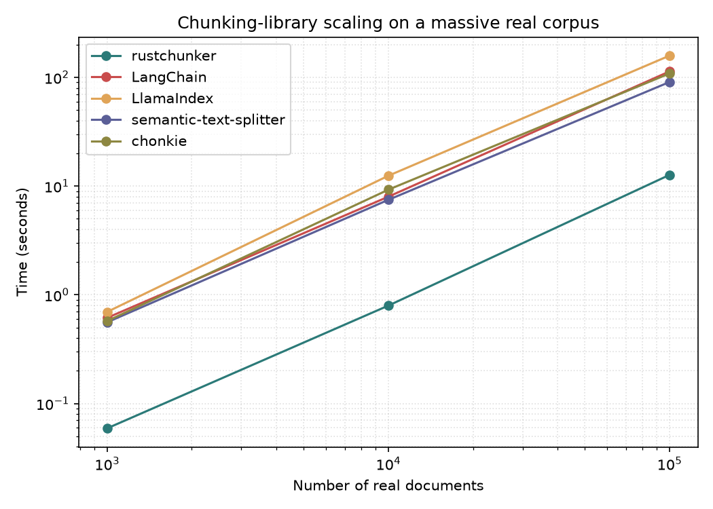
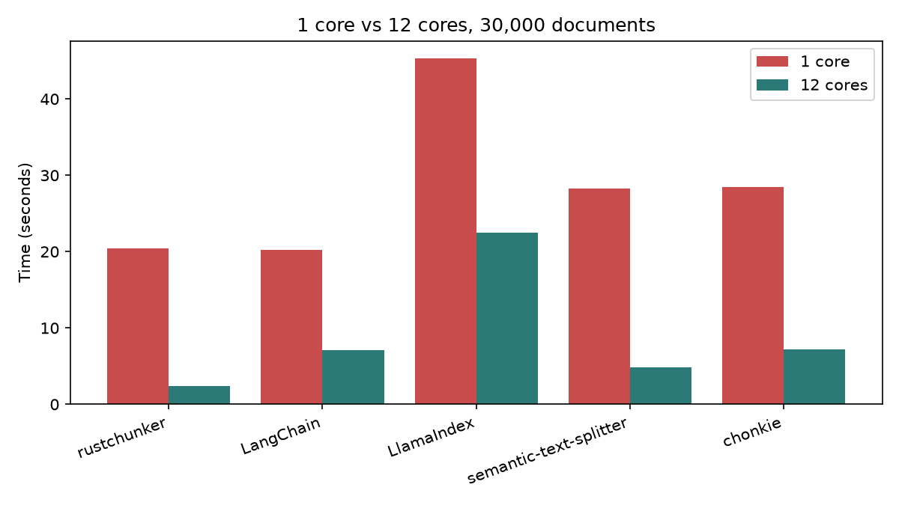
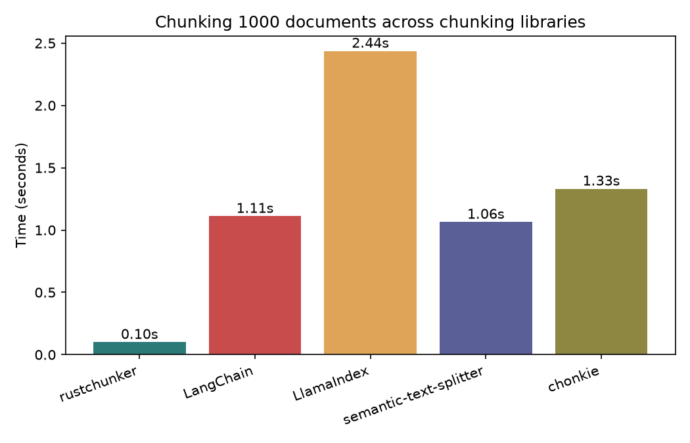
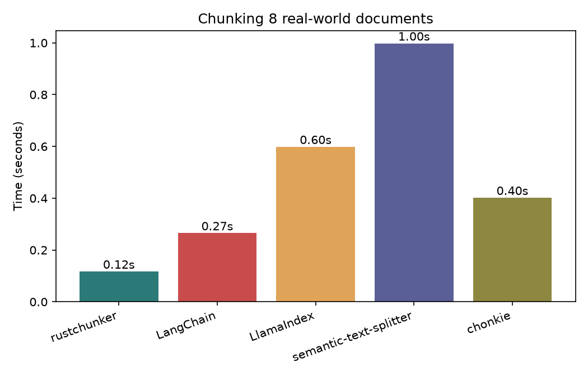
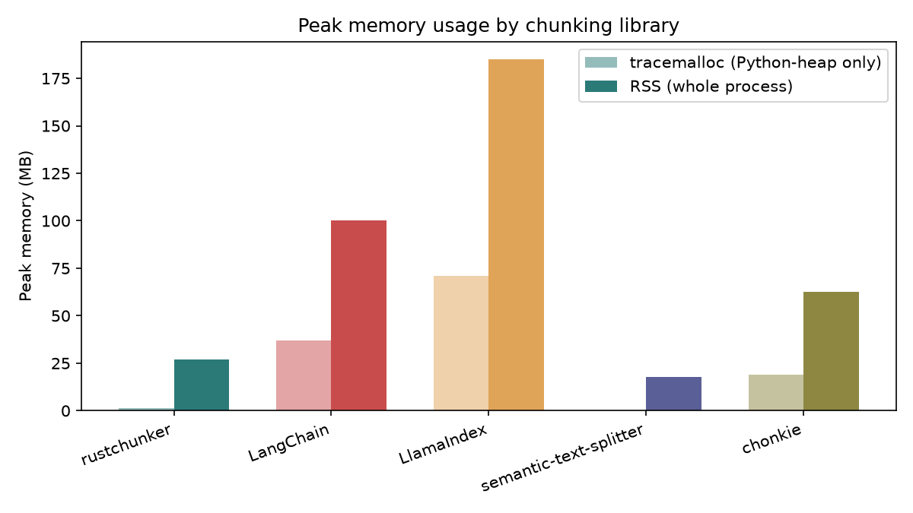
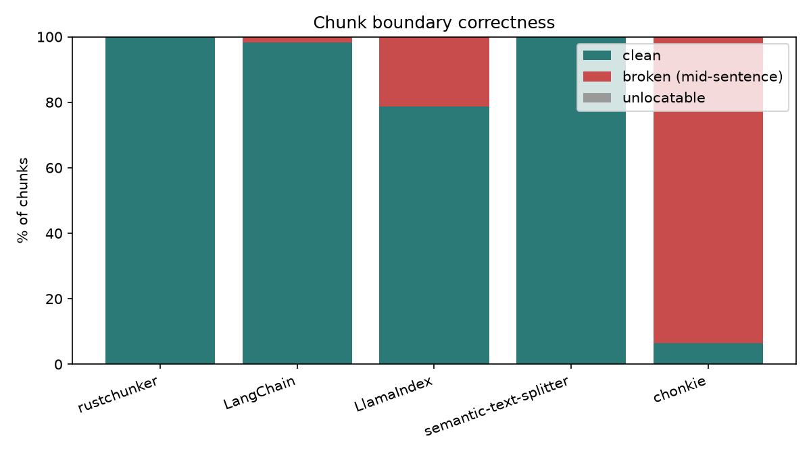

# Benchmarks

Full benchmark report for `rustchunker` vs LangChain
(`RecursiveCharacterTextSplitter`), LlamaIndex (`SentenceSplitter`),
`semantic-text-splitter` (also Rust-based), and `chonkie` (`TokenChunker`).

The README shows only the headline. This document has everything, including
the results that **don't** favour rustchunker — the point is an honest,
reproducible picture, not a highlight reel.

## TL;DR

- **At corpus scale, rustchunker wins big:** 100,000 real documents in
  **~13s** vs **90–158s** for the others (~7–12x).
- **Per core, the lead is modest — roughly tied with LangChain.** The
  order-of-magnitude comes from *efficient parallelism*, not a magically
  faster algorithm. See [§2](#2-where-the-speed-comes-from-rust-core-vs-parallelism).
- **It never splits mid-sentence** (100% clean boundaries vs 6–99% for the
  others).
- **Low memory**, second only to the other Rust library.

## Methodology

- Machine: 12 logical cores. Every table is a **release build**
  (`maturin develop --release`) — a debug build is ~3x slower and not what
  you `pip install`.
- Settings unless noted: `strategy="sentence"`, `max_tokens=256`,
  `overlap=20`. Every library is configured with an equivalent **word-count**
  token budget (custom length function / tokenizer) so the comparison is on
  chunk size, not on differing token units.
- rustchunker uses its parallel `chunk_files` API; the others expose only
  per-text splitting and are driven in the natural sequential Python loop
  (none ships a parallel multi-file API). Where that distinction matters, it
  is measured explicitly — see [§2](#2-where-the-speed-comes-from-rust-core-vs-parallelism).
- This machine is **noisy**; ranges span several runs. Shapes and orderings
  are stable, exact numbers are not.
- Chunk counts differ slightly between libraries (each splits a bit
  differently) — the work is equivalent, not identical.

Reproduce anything below with the commands under each section (all need
`maturin develop --release` first).

---

## 1. Scaling to 100,000 real documents

100,000 unique, full-length real news articles streamed from the
HuggingFace `cc_news` dataset (median ~471 words each — several chunks of
real work per document, not one trivial chunk).

| Library | 1,000 docs | 10,000 docs | 100,000 docs | vs rustchunker @100k |
|---|---|---|---|---|
| **rustchunker** | **0.06s** | **0.80s** | **12.7s** | 1x |
| semantic-text-splitter | 0.56s | 7.48s | 90.6s | 7.1x slower |
| chonkie | 0.57s | 9.27s | 108.7s | 8.6x slower |
| LangChain | 0.61s | 7.99s | 113.5s | 8.9x slower |
| LlamaIndex | 0.70s | 12.45s | 158.4s | 12.5x slower |

At 100k documents rustchunker chunks the entire corpus (~239k chunks) in
**~13 seconds**; the next-fastest takes **1.5 minutes**, LlamaIndex **2.6
minutes**. Normalised by output (chunks/sec, fair across sizes even as
document lengths vary), rustchunker holds **~17,000–24,000 chunks/s at every
scale** while the others stay flat at **~1,400–2,560 chunks/s**. The gap is
stable-to-widening as the corpus grows.



```
pip install -r benchmarks/requirements-extra.txt -r benchmarks/requirements-massive.txt
python benchmarks/fetch_massive_corpus.py --count 100000
python benchmarks/bench_massive_scaling.py --sizes 1000 10000 100000
```

---

## 2. Where the speed comes from: Rust core vs parallelism

The headline compares rustchunker's parallel `chunk_files` against the
others in a sequential loop. That mixes two effects — a faster core, and
using every core while the others use one. This 2×2 (30,000 documents, each
library at **1 core** vs **all 12 cores**) separates them. rustchunker is
pinned with `RAYON_NUM_THREADS`; the competitors are parallelised the only
way a pure-Python splitter can be — a `multiprocessing.Pool` over documents,
with process-spawn and per-worker import cost included, as in practice.

| Library | 1 core | 12 cores | Parallel self-speedup |
|---|---|---|---|
| rustchunker | 15–20s | 1.7–2.4s | **8–9x** |
| semantic-text-splitter | 28–34s | 4.8–6.8s | 5–6x |
| chonkie | 28–36s | 7.2–8.9s | ~4x |
| LangChain | ~20s | 7.1–7.8s | ~2.7x |
| LlamaIndex | 43–45s | 19–22s | ~2x |

**The honest takeaways:**

1. **Per core, rustchunker's lead is modest — roughly even with LangChain**,
   ~1.4–2.8x over the others. The 7–12x from §1 is *not* "Rust is 10x faster
   at splitting text." At one core, rustchunker chunks 30k documents in about
   the same time as LangChain's `RecursiveCharacterTextSplitter`. Its
   `sentence` strategy does real Unicode-correct boundary detection, which
   isn't free.

2. **The decisive advantage is that it parallelises cheaply.** It scales
   ~8–9x on 12 cores; the pure-Python libraries reach only ~2–3x even *with*
   multiprocessing, because their sole route to parallelism pays
   process-spawn, per-worker re-import, and IPC on every run. rustchunker
   uses in-process native threads (`rayon`) with the GIL released — no spawn,
   no re-import, no serialisation. That efficiency, not raw per-character
   speed, is the order of magnitude.

3. **At an equal all-core budget, rustchunker is still ~2–11x faster**
   (~3–5x vs LangChain/chonkie, ~2–4x vs semantic-text-splitter, ~9–11x vs
   LlamaIndex) — real and defensible, now correctly attributed.



```
python benchmarks/bench_massive_parallelism.py --size 30000
```

---

## 3. Head-to-head on 1,000 documents

Synthetic corpus, 1,000 documents, all five libraries (release builds).

| Library | vs rustchunker |
|---|---|
| rustchunker (~0.10s) | 1x |
| LangChain | ~10–11x slower |
| semantic-text-splitter | ~10–11x slower |
| chonkie | ~13–14x slower |
| LlamaIndex | ~24x slower |

Even against `semantic-text-splitter` — also Rust, no per-call algorithmic
disadvantage — rustchunker's batched parallel `chunk_files` comes out ahead,
because it does the whole batch in one parallel native call instead of
crossing the Python↔native boundary once per file. (Per-core, the two are
much closer — see §2.)



```
pip install -r benchmarks/requirements-extra.txt
python benchmarks/generate_test_data.py --count 1000
python benchmarks/bench_vs_all.py
```

---

## 4. Real-world messy documents

8 real documents: 3 Project Gutenberg novels (`.txt`, 450–770 KB), 2
Wikipedia articles (`.html` via the REST API, 875 KB and 1.9 MB), 3 popular
GitHub `README.md` files.

| Library | Time (8 docs) |
|---|---|
| **rustchunker** | **0.11–0.14s** |
| LangChain | 0.25–0.31s |
| chonkie | 0.33–0.40s |
| LlamaIndex | 0.60–0.81s |
| semantic-text-splitter | 0.99–1.43s |

This corpus caught a real bug worth recording: the HTML reader's
`strip_tag_block` was `O(n²)` — its case-insensitive search allocated a
fully Unicode-lowercased copy of the *entire remaining document* on every
`<script>`/`<style>` tag. On the 1.9 MB Wikipedia file that was ~133 ms of
pure waste (more than the actual HTML parse). It was also subtly *incorrect*:
lowercasing non-ASCII content shifts byte offsets. Replaced with an
allocation-free ASCII byte scan — that phase went ~133 ms → ~5 ms, and is
now correct on Unicode-heavy HTML.

Only rustchunker's readers strip markdown/HTML; the other libraries receive
raw file content (in real use you'd pair them with a separate loader), so
the `.md`/`.html` rows reflect realistic default usage rather than a pure
algorithm race.



```
pip install -r benchmarks/requirements-extra.txt
python benchmarks/fetch_real_docs.py
python benchmarks/bench_real_docs.py --out benchmarks/bench_real_docs_after_fix.png
```

---

## 5. Memory

Peak memory chunking 1,000 documents, each library in an isolated
subprocess. `tracemalloc` = Python-heap only; **RSS** (via `psutil`) = whole
process, the number to trust across languages.

| Library | tracemalloc peak | RSS peak |
|---|---|---|
| semantic-text-splitter | 0.1MB | **17.8MB** |
| rustchunker | 1.2MB | 27.0MB |
| chonkie | 18.9MB | 62.5MB |
| LangChain | 36.8MB | 100.3MB |
| LlamaIndex | 71.0MB | 185.2MB |

Reported as measured, including the part that doesn't favour us:
**`semantic-text-splitter` has the lowest RSS**, below rustchunker — likely
because rustchunker's `Chunk` carries a `metadata` dict on every chunk that a
plain list-of-strings output doesn't. rustchunker is still far below the
pure-Python libraries.



```
pip install -r benchmarks/requirements-extra.txt
python benchmarks/bench_memory.py
```

---

## 6. Chunk boundary correctness

Speed isn't everything — a chunk that ends mid-sentence is worse retrieval
context. This measures whether each library's chunk *ends* land on real
sentence boundaries (ground truth = rustchunker's own independently-tested
Unicode sentence detection; other libraries' chunks are relocated in the
source by substring search, with unlocatable chunks reported separately).
30 synthetic + 8 real documents.

| Library | Clean | Broken (mid-sentence) |
|---|---|---|
| **rustchunker** | **100.0%** | 0.0% |
| semantic-text-splitter | 100.0% | 0.0% |
| LangChain | 98.4% | 1.6% |
| LlamaIndex | 78.8% | 21.2% |
| chonkie | 6.5% | 93.5% |

Context matters: `chonkie`'s `TokenChunker` is a pure token-window splitter
with no linguistic awareness, so a low score is by design. LangChain scores
well mostly because its separator hierarchy tends to land on sentence ends
for prose. `LlamaIndex`'s `SentenceSplitter` — which specifically promises
sentence awareness — landing at 78.8% is the notable result.

Building this comparison surfaced (and fixed) two real bugs in rustchunker:
a backwards abbreviation-merge that meant "Dr." was never actually kept with
the following sentence, and `Chunk.start`/`end` being Rust *byte* offsets
instead of Python *character* offsets (silently wrong for any non-ASCII
text). Both are fixed and regression-tested.



```
pip install -r benchmarks/requirements-extra.txt
python benchmarks/bench_correctness.py
```

---

## Appendix: the debug-build lesson

An earlier version of this report was accidentally measured on **debug**
builds of rustchunker (plain `maturin develop`), which are ~3x slower and
handicapped it against the always-optimised Python libraries — at one point
making it look *slower* on real documents. Every number here is a release
build. Lesson kept on the record: for a compiled extension, always benchmark
`--release`; a debug timing is meaningless.
