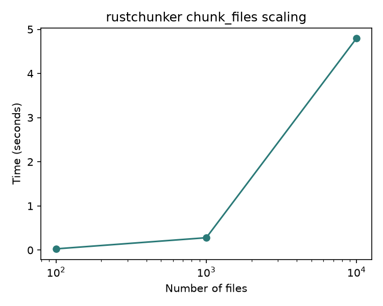
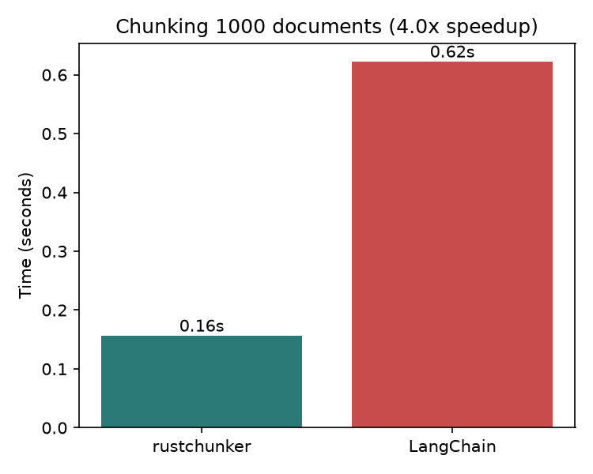
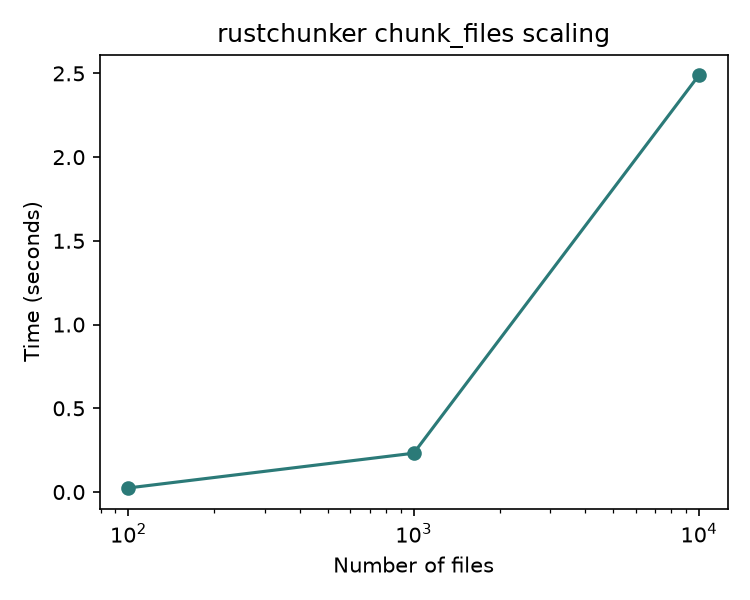
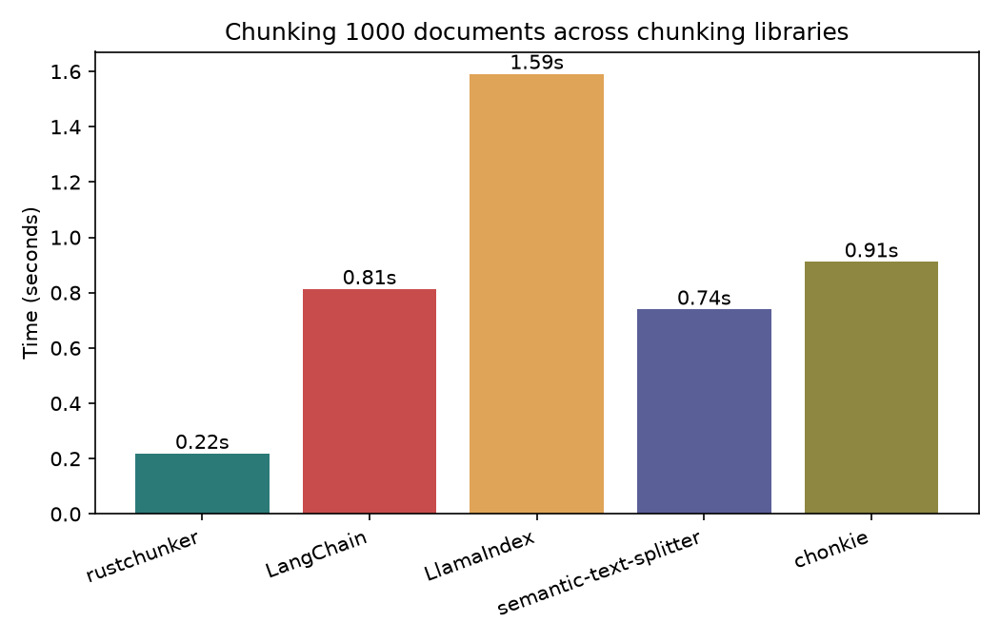

# rustchunker

A fast document chunking library for RAG pipelines. Core engine written in
Rust (PyO3 + maturin), exposed to Python.

## Why

Python chunking libraries (LangChain's `RecursiveCharacterTextSplitter`,
LlamaIndex's `SentenceSplitter`) are single-threaded and slow at scale.
rustchunker does the same job faster by running the actual chunking logic
in Rust, with parallel multi-file processing via `rayon`.

## Benchmarks

Measured on this machine (12 cores), 1000 synthetic documents, `sentence`
strategy, `max_tokens=256`, `overlap=20`, vs LangChain's
`RecursiveCharacterTextSplitter` (word-count length function for a fair
token-budget comparison):

| Document size (~words) | rustchunker | LangChain | Speedup |
|---|---|---|---|
| ~300  | 0.18s | 0.98s | 5.5x |
| ~2000 | 1.27s | 1.62s | 1.3x |

The speedup is largest for typical short-to-medium documents. It shrinks
for very large single documents because LangChain's recursive splitter is
also roughly linear in document size on well-structured text — the
constant-factor advantage of Rust plus parallel file processing matters
most when there are many documents to get through, not when a single
document dominates the workload.


### Scaling across file counts

`chunk_files` throughput across different corpus sizes (same settings as
above):

| Files | Time | Chunks/sec |
|---|---|---|
| 100 | 0.03s | ~7,000 |
| 1,000 | 0.28s | ~7,100 |
| 10,000 | 4.80s | ~4,200 |

Throughput holds steady up to a few thousand files; at very high file
counts, fixed per-file overhead (opening/reading many small files) starts
to dominate over the actual chunking work.



Reproduce with:
```
pip install -r benchmarks/requirements.txt
python benchmarks/generate_test_data.py --count 1000
python benchmarks/bench_vs_langchain.py
python benchmarks/bench_scaling.py
```

## Performance improvements

An investigation into the two numbers above (why the LangChain speedup
shrinks on large documents, and why `chunk_files` throughput dropped at
10,000 files) found two real, fixable issues, plus a profiling result
worth recording. The sections above are left as originally measured for
comparison; this section adds the "after" numbers from the same,
unmodified benchmark scripts.

**What was fixed:**
- `apply_overlap` was re-tokenizing the *entire* document from scratch on
  every call, even though the `fixed` strategy had already computed the
  same token spans moments earlier and discarded them. Every benchmark
  above uses `overlap=20`, so this redundant full-document scan was
  running on every single chunk call. Fixed by computing token spans once
  and threading them through — output is byte-identical, verified by the
  full existing test suite (18 Rust + 23 Python tests) passing unchanged.
- `chunk_files` built its output `Vec<Chunk>` via repeated `push` from
  empty, instead of pre-sizing it with the already-known total chunk
  count. This turned out to be the dominant cost behind the 10,000-file
  slowdown — not filesystem I/O as originally suspected.

**Results** (same methodology as above; re-run several times since this
machine shows meaningful run-to-run variance — numbers below are
representative, not best-case):

| Document size (~words) | rustchunker (before) | rustchunker (after) | Speedup vs LangChain (before → after) |
|---|---|---|---|
| ~300  | 0.18s | 0.16s | 5.5x → 4.0x* |
| ~2000 | 1.27s | 0.90s | 1.3x → 1.9x |

*\*Small-document speedup varies 4-5.5x across runs due to system noise; the underlying rustchunker time itself improved or held steady in every run — it did not regress.*



| Files | Chunks/sec (before) | Chunks/sec (after) |
|---|---|---|
| 100 | ~7,000 | ~8,200 |
| 1,000 | ~7,100 | ~8,600 |
| 10,000 | ~4,200 (degrading) | ~8,000 (steady) |

The key change isn't the absolute numbers (which are noisy on this
machine) but the *shape*: throughput no longer drops as file count grows
— the 10,000-file case used to be the slowest per-chunk, and now performs
in the same range as 100/1,000 files.



**What was investigated but not changed:** profiling (via targeted
`#[ignore]`-marked diagnostic tests, not shipped as part of the normal
test suite) found that for the `sentence` strategy, 85-97% of chunking
time is spent inside the `unicode-segmentation` crate's sentence-boundary
detection itself — tokenization, overlap, and final string allocation are
all under a few percent each. This rules out a `memchr`-based tokenizer
speedup (confirmed not to be the bottleneck) and means the only remaining
lever for large single documents is intra-document parallelism (splitting
a document into sections and detecting sentence boundaries in parallel).
That was evaluated and deliberately not pursued for now: it would change
overlap behavior right at artificial section-boundary points, a real
semantics tradeoff versus today's exact sequential behavior, for a case
(single very large documents) that's less central to typical RAG chunking
than the many-files case already fixed above.

Reproduce with the same commands as above (this section re-runs the
identical scripts, just with `--out` pointed at different filenames so
the original charts above stay untouched):
```
python benchmarks/bench_vs_langchain.py --out benchmarks/bench_vs_langchain_after_fix.png
python benchmarks/bench_scaling.py --out benchmarks/bench_scaling_after_fix.png
```

## Comparison against more chunking libraries

Same 1000-document corpus and word-count token budget (`max_tokens=256`,
`overlap=20`) as above, extended to the other chunking libraries people
tend to ask about, including `semantic-text-splitter` (also Rust-based —
the closest direct competitor). Each library is configured with an
equivalent word-count callback/tokenizer rather than its own default, so
the comparison is on chunk size, not units. All libraries process files
in a plain Python loop (none of them has a built-in parallel multi-file
API) — that loop, not just per-call algorithm speed, is part of what's
being measured.

| Library | Version | Time (1000 docs) | vs rustchunker |
|---|---|---|---|
| rustchunker | 0.1.0 | 0.22s | 1x |
| LangChain (`RecursiveCharacterTextSplitter`) | 1.1.2 | 0.81s | 3.7x slower |
| LlamaIndex (`SentenceSplitter`) | 0.14.23 | 1.59s | 7.3x slower |
| semantic-text-splitter | 0.32.0 | 0.74s | 3.4x slower |
| chonkie (`TokenChunker`) | 1.7.0 | 0.91s | 4.2x slower |

Numbers vary run to run (see the caveat above), but the relative
ordering was consistent across repeated runs: rustchunker fastest,
`semantic-text-splitter` and LangChain close behind each other, then
chonkie, then LlamaIndex slowest. Notably, even against a Rust-based
competitor with no per-call algorithmic disadvantage, rustchunker's
`chunk_files` still comes out ahead — it batches all files through one
parallel call instead of crossing the Python↔native boundary once per
file in a loop.



Reproduce with:
```
pip install -r benchmarks/requirements-extra.txt
python benchmarks/bench_vs_all.py
```
