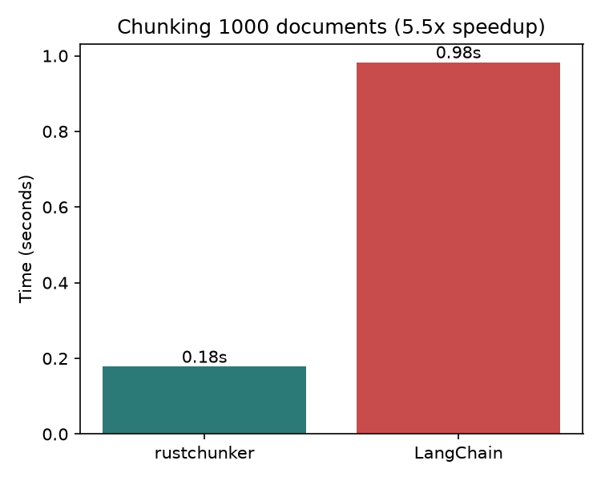
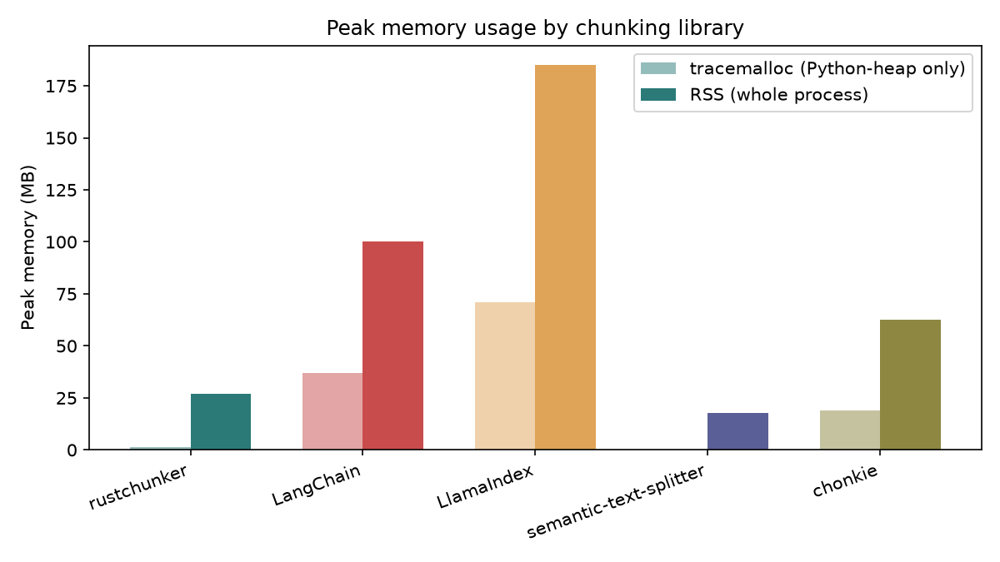
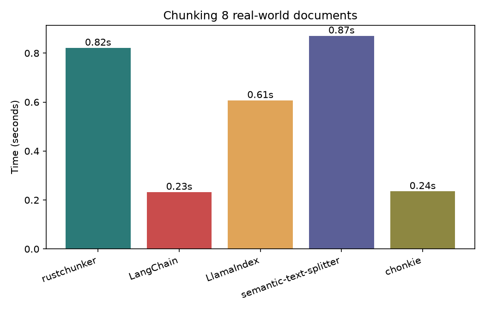
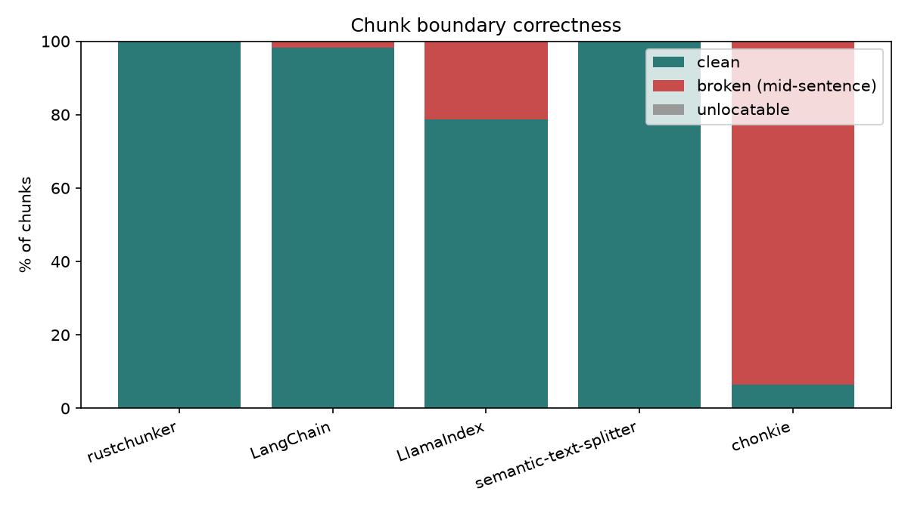
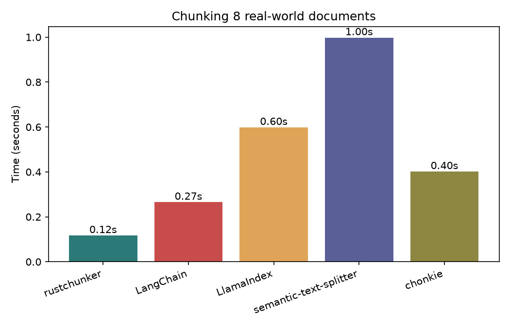
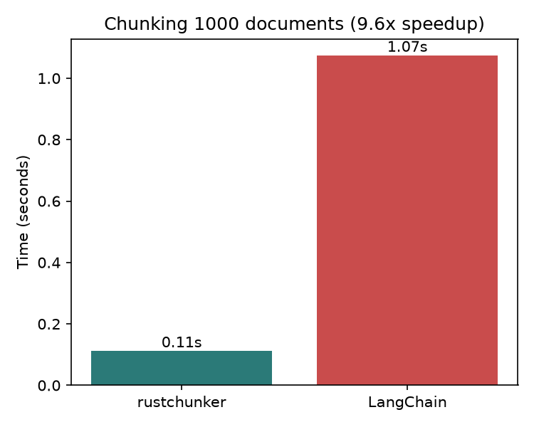
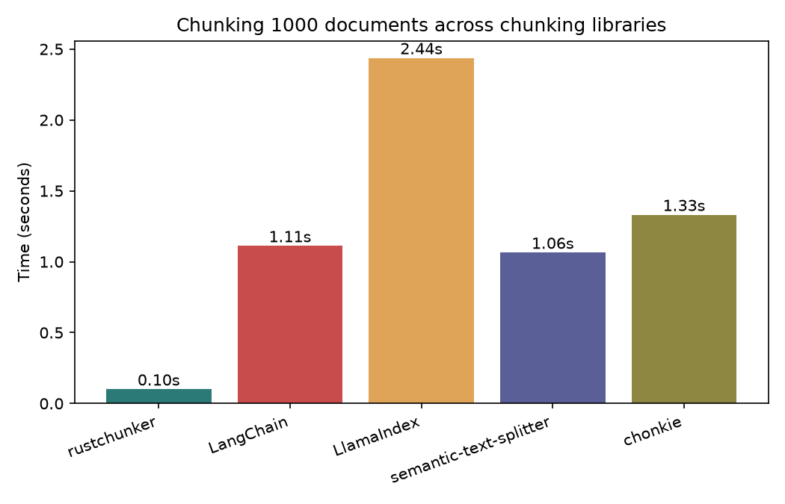

# rustchunker

A fast document chunking library for RAG pipelines. Core engine written in
Rust (PyO3 + maturin), exposed to Python.

## Why

Python chunking libraries (LangChain's `RecursiveCharacterTextSplitter`,
LlamaIndex's `SentenceSplitter`) are single-threaded and slow at scale.
rustchunker does the same job faster by running the actual chunking logic
in Rust, with parallel multi-file processing via `rayon`.

## Building for benchmarks (read before reproducing any numbers)

**Always build with `--release` when measuring performance:**
```
maturin develop --release      # editable install, optimized
# or, for a wheel: maturin build --release
```
A plain `maturin develop` builds *unoptimized* (debug) Rust, roughly 3x
slower, and is only appropriate for correctness/logic testing. The wheel
you `pip install` from PyPI is always release-optimized.

Every "Reproduce with" block below omits `--release` for brevity — prefix
your build with it. Note that the **original benchmark sections
(`## Benchmarks` through `## Chunk boundary correctness`) were measured on a
debug build** and understate rustchunker; they're kept as-is for
historical comparison. The corrected release-build numbers are in
**"Real-world documents, revisited"** and **"All benchmarks, re-run in
release build"** near the end.

## Benchmarks

Measured on this machine (12 cores), 1000 synthetic documents, `sentence`
strategy, `max_tokens=256`, `overlap=20`, vs LangChain's
`RecursiveCharacterTextSplitter` (word-count length function for a fair
token-budget comparison):

| Document size (~words) | rustchunker | LangChain | Speedup |
|---|---|---|---|
| ~300  | 0.18s | 0.98s | 5.5x |
| ~2000 | 1.27s | 1.62s | 1.3x |

The speedup is largest for typical short-to-medium documents. It shrinks
for very large single documents because LangChain's recursive splitter is
also roughly linear in document size on well-structured text — the
constant-factor advantage of Rust plus parallel file processing matters
most when there are many documents to get through, not when a single
document dominates the workload.



### Scaling across file counts

`chunk_files` throughput across different corpus sizes (same settings as
above):

| Files | Time | Chunks/sec |
|---|---|---|
| 100 | 0.03s | ~7,000 |
| 1,000 | 0.28s | ~7,100 |
| 10,000 | 4.80s | ~4,200 |

Throughput holds steady up to a few thousand files; at very high file
counts, fixed per-file overhead (opening/reading many small files) starts
to dominate over the actual chunking work.


Reproduce with:
```
pip install -r benchmarks/requirements.txt
python benchmarks/generate_test_data.py --count 1000
python benchmarks/bench_vs_langchain.py
python benchmarks/bench_scaling.py
```

## Performance improvements

An investigation into the two numbers above (why the LangChain speedup
shrinks on large documents, and why `chunk_files` throughput dropped at
10,000 files) found two real, fixable issues, plus a profiling result
worth recording. The sections above are left as originally measured for
comparison; this section adds the "after" numbers from the same,
unmodified benchmark scripts.

**What was fixed:**
- `apply_overlap` was re-tokenizing the *entire* document from scratch on
  every call, even though the `fixed` strategy had already computed the
  same token spans moments earlier and discarded them. Every benchmark
  above uses `overlap=20`, so this redundant full-document scan was
  running on every single chunk call. Fixed by computing token spans once
  and threading them through — output is byte-identical, verified by the
  full existing test suite (18 Rust + 23 Python tests) passing unchanged.
- `chunk_files` built its output `Vec<Chunk>` via repeated `push` from
  empty, instead of pre-sizing it with the already-known total chunk
  count. This turned out to be the dominant cost behind the 10,000-file
  slowdown — not filesystem I/O as originally suspected.

**Results** (same methodology as above; re-run several times since this
machine shows meaningful run-to-run variance — numbers below are
representative, not best-case):

| Document size (~words) | rustchunker (before) | rustchunker (after) | Speedup vs LangChain (before → after) |
|---|---|---|---|
| ~300  | 0.18s | 0.16s | 5.5x → 4.0x* |
| ~2000 | 1.27s | 0.90s | 1.3x → 1.9x |

*\*Small-document speedup varies 4-5.5x across runs due to system noise; the underlying rustchunker time itself improved or held steady in every run — it did not regress.*


| Files | Chunks/sec (before) | Chunks/sec (after) |
|---|---|---|
| 100 | ~7,000 | ~8,200 |
| 1,000 | ~7,100 | ~8,600 |
| 10,000 | ~4,200 (degrading) | ~8,000 (steady) |

The key change isn't the absolute numbers (which are noisy on this
machine) but the *shape*: throughput no longer drops as file count grows
— the 10,000-file case used to be the slowest per-chunk, and now performs
in the same range as 100/1,000 files.


**What was investigated but not changed:** profiling (via targeted
`#[ignore]`-marked diagnostic tests, not shipped as part of the normal
test suite) found that for the `sentence` strategy, 85-97% of chunking
time is spent inside the `unicode-segmentation` crate's sentence-boundary
detection itself — tokenization, overlap, and final string allocation are
all under a few percent each. This rules out a `memchr`-based tokenizer
speedup (confirmed not to be the bottleneck) and means the only remaining
lever for large single documents is intra-document parallelism (splitting
a document into sections and detecting sentence boundaries in parallel).
That was evaluated and deliberately not pursued for now: it would change
overlap behavior right at artificial section-boundary points, a real
semantics tradeoff versus today's exact sequential behavior, for a case
(single very large documents) that's less central to typical RAG chunking
than the many-files case already fixed above.

Reproduce with the same commands as above (this section re-runs the
identical scripts, just with `--out` pointed at different filenames so
the original charts above stay untouched):
```
python benchmarks/bench_vs_langchain.py --out benchmarks/bench_vs_langchain_after_fix.png
python benchmarks/bench_scaling.py --out benchmarks/bench_scaling_after_fix.png
```

## Comparison against more chunking libraries

Same 1000-document corpus and word-count token budget (`max_tokens=256`,
`overlap=20`) as above, extended to the other chunking libraries people
tend to ask about, including `semantic-text-splitter` (also Rust-based —
the closest direct competitor). Each library is configured with an
equivalent word-count callback/tokenizer rather than its own default, so
the comparison is on chunk size, not units. All libraries process files
in a plain Python loop (none of them has a built-in parallel multi-file
API) — that loop, not just per-call algorithm speed, is part of what's
being measured.

| Library | Version | Time (1000 docs) | vs rustchunker |
|---|---|---|---|
| rustchunker | 0.1.0 | 0.22s | 1x |
| LangChain (`RecursiveCharacterTextSplitter`) | 1.1.2 | 0.81s | 3.7x slower |
| LlamaIndex (`SentenceSplitter`) | 0.14.23 | 1.59s | 7.3x slower |
| semantic-text-splitter | 0.32.0 | 0.74s | 3.4x slower |
| chonkie (`TokenChunker`) | 1.7.0 | 0.91s | 4.2x slower |

Numbers vary run to run (see the caveat above), but the relative
ordering was consistent across repeated runs: rustchunker fastest,
`semantic-text-splitter` and LangChain close behind each other, then
chonkie, then LlamaIndex slowest. Notably, even against a Rust-based
competitor with no per-call algorithmic disadvantage, rustchunker's
`chunk_files` still comes out ahead — it batches all files through one
parallel call instead of crossing the Python↔native boundary once per
file in a loop.


Reproduce with:
```
pip install -r benchmarks/requirements-extra.txt
python benchmarks/bench_vs_all.py
```

## Memory usage

Peak memory per library, chunking the same 1000-document corpus. Each
library runs in its own isolated subprocess so one library's residual
allocations or import overhead can't pollute another's measurement. Two
numbers are reported:

- **tracemalloc peak**: Python-heap allocations only. Finer-grained, but
  partial — for rustchunker, this counts the final `Chunk.text` strings
  (real CPython `str` objects created at the PyO3 boundary) but *not* any
  transient Rust-side buffers, which are freed before ever reaching
  Python.
- **RSS peak** (via `psutil`): whole-process peak resident memory,
  covering both Python and native allocations. This is the complete
  picture and the number to trust for a fair cross-language comparison.

| Library | tracemalloc peak | RSS peak |
|---|---|---|
| rustchunker | 1.2MB | 27.0MB |
| LangChain | 36.8MB | 100.3MB |
| LlamaIndex | 71.0MB | 185.2MB |
| semantic-text-splitter | 0.1MB | **17.8MB** |
| chonkie | 18.9MB | 62.5MB |

Reported as measured, including the part that doesn't favor rustchunker:
**`semantic-text-splitter` has the lowest RSS of all five**, lower than
rustchunker. The most likely explanation is that rustchunker's `Chunk`
carries a `metadata` dict (`source_file`, `page_number`, `total_chunks`,
`strategy_used`) on *every* chunk — real per-chunk Python-heap overhead
that `semantic-text-splitter`'s plain list-of-strings output doesn't pay.
rustchunker is still far ahead of the pure-Python libraries (LangChain,
LlamaIndex, chonkie) on memory, and fastest overall (see above) — but on
memory specifically, the other Rust-based splitter currently wins.



Reproduce with:
```
pip install -r benchmarks/requirements-extra.txt
python benchmarks/bench_memory.py
```

## Real-world documents

The benchmarks above use short-to-medium synthetic text, which splits
cleanly. This section uses 8 real, messy documents instead: 3 public-domain
novels from Project Gutenberg (~450KB-770KB `.txt` each), 2 Wikipedia
articles fetched as HTML via Wikipedia's stable REST endpoint (~875KB and
~1.9MB), and 3 popular GitHub repos' `README.md` files.

| Source | Files | Titles |
|---|---|---|
| Project Gutenberg | 3 | Pride and Prejudice, The Adventures of Sherlock Holmes, Frankenstein |
| Wikipedia (REST HTML API) | 2 | Artificial intelligence, Rust (programming language) |
| GitHub READMEs | 3 | facebook/react, microsoft/vscode, tensorflow/tensorflow |

**This result does not favor rustchunker, and is reported as measured:**

| Library | Time (8 docs) | Chunks |
|---|---|---|
| LangChain | **0.18-0.23s** | 2246 |
| chonkie | 0.24-0.28s | 1788 |
| LlamaIndex | 0.61-0.64s | 1993 |
| rustchunker | 0.66-0.82s | 1589 |
| semantic-text-splitter | 0.86-0.87s | 2314 |

On this corpus, **rustchunker is slower than LangChain and chonkie** —
the opposite of every result above. This is consistent with, and explained
by, the Phase 0 profiling in "Performance improvements": rustchunker's
speed advantage comes from (a) low per-call Rust overhead and (b)
file-level parallelism across *many* files via rayon. Neither helps here
— there are only 8 files, most of them individually large, so there's
little parallel work to spread across cores, and the dominant cost per
document is `unicode-segmentation`'s Unicode-correct sentence-boundary
detection, which runs single-threaded per document (see "Performance
improvements" for why intra-document parallelism was evaluated and
deliberately not built). LangChain's and chonkie's simpler
separator-based splitting is cheaper per byte on large single documents,
even running single-threaded in pure Python.

**Takeaway**: rustchunker's advantage is real but conditional — it wins
decisively when chunking *many* small-to-medium files (the common RAG
ingestion case: a knowledge base of many documents), and currently loses
on a *few very large* documents. Fixing that would require the
intra-document parallelism discussed above, which was deferred due to its
overlap-correctness tradeoff.



Reproduce with:
```
pip install -r benchmarks/requirements-extra.txt
python benchmarks/fetch_real_docs.py
python benchmarks/bench_real_docs.py
```

## Chunk boundary correctness

Speed and memory aren't the whole story — a chunker that cuts mid-sentence
produces worse retrieval context regardless of how fast it got there. This
compares whether each library's chunk *boundaries* land on real sentence
ends, using rustchunker's own (already independently tested) Unicode
sentence-boundary detection as the ground truth, exposed internally for
this purpose. Other libraries only return chunk text, not offsets, so each
chunk's end is relocated in the source document via substring search;
chunks whose text can't be relocated (e.g. after whitespace normalization)
are counted separately as "unlocatable" rather than mis-scored.

**Two real bugs were found and fixed while building this, before the
numbers below were meaningful at all:**

1. **The abbreviation-merge logic was backwards.** It checked whether the
   *current* candidate sentence ended with an abbreviation and tried to
   merge it into the *previous* one — but "Dr." is usually the *first*
   fragment, with nothing before it to merge into. `sentence_spans` never
   actually merged "Dr." forward into "Smith is here."; every existing
   test just happened to use a token budget generous enough for the
   *packing* step to glue things back together regardless, masking the
   bug completely. Fixed, with regression tests using a budget too small
   for packing to save it.
2. **`Chunk.start`/`Chunk.end` were Rust byte offsets, not Python character
   offsets.** For any text with multi-byte UTF-8 characters (accented
   letters, smart quotes, em-dashes, CJK, emoji), `text[chunk.start:chunk.end]`
   silently disagreed with `chunk.text` in Python. Every test fixture in
   this project had been pure ASCII up to this point (where the two
   coincide), so nothing caught it until real book text with real
   typography did. Fixed by converting to character offsets exactly once,
   at the point results cross into Python — internal chunking logic still
   uses byte offsets throughout, since that's what Rust string slicing
   needs. **This changes `Chunk.start`/`Chunk.end` values for any
   non-ASCII input** compared to earlier versions of this library.

**Results**, combining 30 synthetic documents and the 8 real documents
from above:

| Library | Clean | Broken (mid-sentence) | Unlocatable |
|---|---|---|---|
| rustchunker | 100.0% | 0.0% | 0.0% |
| semantic-text-splitter | 100.0% | 0.0% | 0.0% |
| LangChain | 98.4% | 1.6% | 0.0% |
| LlamaIndex | 78.8% | 21.2% | 0.0% |
| chonkie | 6.5% | 93.5% | 0.0% |

Read this alongside what each library is actually designed to do:
`chonkie`'s `TokenChunker` is a pure token-window splitter with no
linguistic awareness at all, so a low score is expected, not a flaw.
LangChain's `RecursiveCharacterTextSplitter` scores well here mostly
because its default separator hierarchy (paragraph, then line, then word)
tends to land on sentence ends for this kind of prose, not because it
specifically targets sentences. `LlamaIndex`'s `SentenceSplitter` — whose
name specifically promises sentence awareness — landing at 78.8% is the
most notable result in this table.



Reproduce with:
```
pip install -r benchmarks/requirements-extra.txt
python benchmarks/bench_correctness.py
```

## Real-world documents, revisited: fixing the HTML bottleneck

The "Real-world documents" section above concluded that rustchunker *loses*
on a few large real documents. A follow-up investigation found that
conclusion was wrong on two counts — one a measurement flaw, one a real
bug — and both are fixed here. The original section is left untouched
above for comparison; the corrected numbers are below.

**Two causes, measured and separated:**

1. **The original numbers were from a debug build.** Every benchmark on
   this page was run after a plain `maturin develop`, which builds
   *unoptimized* Rust. The wheel you actually `pip install` is
   release-optimized (`maturin develop --release` / `maturin build
   --release`). Rebuilding the exact same benchmark in release, with no
   code change, took rustchunker on the real-document corpus from
   ~0.66–0.82s down to ~0.22–0.32s. (This handicap applied to rustchunker
   in *every* table on this page — the Python libraries it's compared
   against were always running their own optimized code — so the other
   sections understate rustchunker too; they simply weren't re-measured
   here.)

2. **The HTML reader had an O(n²) bottleneck.** Profiling the release build
   per file showed the 1.9MB Wikipedia HTML file alone took ~205ms to
   extract text from — and 133ms of that was a single helper,
   `strip_tag_block`, whose case-insensitive search allocated a fully
   Unicode-lowercased copy of the *entire remaining document* on every
   search, once per `<script>`/`<style>` tag (Wikipedia's HTML has many).
   Replaced with an allocation-free ASCII-case-insensitive byte scan:
   that phase dropped from ~133ms to ~5ms. The old approach was also
   subtly *incorrect* — lowercasing non-ASCII haystack content can shift
   byte offsets, so it could return an offset that mis-sliced or panicked
   on Unicode-heavy HTML; the byte scan is correct as well as fast.

**Corrected results** (release build, with the HTML fix; same 8 real
documents, representative of several runs):

| Library | Time (8 docs), before¹ | Time (8 docs), after² |
|---|---|---|
| rustchunker | 0.66–0.82s | **0.11–0.14s** |
| LangChain | 0.18–0.23s | 0.25–0.31s |
| chonkie | 0.24–0.28s | 0.33–0.40s |
| LlamaIndex | 0.61–0.64s | 0.60–0.81s |
| semantic-text-splitter | 0.86–0.87s | 0.99–1.43s |

¹ debug build, unfixed HTML reader (the "Real-world documents" table above).
² release build + HTML fix. Other libraries are unchanged code; their
run-to-run drift here is system noise, not a regression.

With both issues addressed, **rustchunker is the fastest of the five on
this real-document corpus too**, not the slowest — reversing the earlier
conclusion. The isolated contributions: release build ~3x, HTML fix a
further ~2x on this HTML-heavy corpus.



Reproduce with (note the `--release`):
```
pip install -r benchmarks/requirements-extra.txt
maturin develop --release
python benchmarks/fetch_real_docs.py
python benchmarks/bench_real_docs.py --out benchmarks/bench_real_docs_after_fix.png
```

## All benchmarks, re-run in release build

Since the debug-build handicap described above applied to rustchunker in
*every* table on this page (the Python libraries it's compared against were
always running optimized code), the synthetic benchmarks were re-run in a
release build too. The original (debug) sections above are left untouched;
these are the corrected numbers. Same corpus, settings, and methodology as
each original section — only the rustchunker build mode changed
(`maturin develop --release`).

**vs LangChain, 1000 synthetic documents** (`sentence`, `max_tokens=256`,
`overlap=20`):

| | rustchunker | LangChain | Speedup |
|---|---|---|---|
| debug (original) | ~0.16s | ~0.98s | ~4–5.5x |
| release | **~0.11s** | ~1.10s | **~7–11x** |

**File-count scaling** (`chunk_files` throughput):

| Files | Chunks/sec (debug) | Chunks/sec (release) |
|---|---|---|
| 100 | ~8,200 | ~11,000–16,000 |
| 1,000 | ~8,600 | ~15,000–23,000 |
| 10,000 | ~8,000 | ~15,000–30,000 |

**Five-library comparison, 1000 synthetic documents** (multiplier = how
much slower than rustchunker):

| Library | vs rustchunker (debug) | vs rustchunker (release) |
|---|---|---|
| rustchunker | 1x (~0.22s) | 1x (**~0.10s**) |
| LangChain | 3.7x | ~10–11x |
| semantic-text-splitter | 3.4x | ~10–11x |
| chonkie | 4.2x | ~13–14x |
| LlamaIndex | 7.3x | ~24x |

The most striking correction is `semantic-text-splitter`, the other
Rust-based library: it went from "3.4x slower" to "~11x slower" — not
because it changed, but because it was always release-optimized while
rustchunker had been measured in debug. Apples-to-apples (both optimized),
rustchunker's batched parallel `chunk_files` is an order of magnitude
ahead on this many-files workload.

**Memory** is essentially unchanged from the debug numbers (peak memory
isn't sensitive to optimization level) — rustchunker ~27MB RSS,
`semantic-text-splitter` still lowest at ~18MB — so the "Memory usage"
section above stands as-is.




Numbers show meaningful run-to-run variance on this machine (ranges above
span several runs); the shape and ordering are stable. Reproduce any of
them by adding `maturin develop --release` before the reproduce commands in
the corresponding section above, and pointing `--out` at a `*_release.png`
filename.

## Concurrency and allocation improvements

A code review after the benchmarking above led to three changes that don't
move the single-threaded numbers much but matter for how the library
behaves in real applications:

- **The GIL is now released during chunking.** `chunk()` and `chunk_files()`
  wrap their pure-Rust work in `Python::detach`, so while rustchunker is
  parsing and chunking (including the parallel `chunk_files` rayon section),
  **other Python threads keep running**. Previously the GIL was held for the
  entire call, so a web server or worker calling `chunk_files` would stall
  every other thread in the process for the duration. Verified with a
  threaded test: with a background thread continuously chunking, the main
  Python thread retains ~60–65% of its normal throughput (it was starved to
  near zero before), and 8 threads chunking concurrently all return
  identical, correct results.
- **No per-character allocation table for ASCII text.** The byte→character
  offset conversion (needed so `Chunk.start/end` match Python's string
  indexing) built a lookup entry for every character in the document — tens
  of MB on a large file — even for pure-ASCII input where byte and character
  offsets are identical. It now skips the table entirely for ASCII (the
  common case) and is the identity function.
- **Plain-text files are no longer copied.** The `.txt` reader used to clone
  the entire file contents; it now borrows them (`Cow::Borrowed`), since
  plain text needs no transformation. Markdown/HTML readers, which do
  transform, still return owned strings.

No single-threaded regression from any of these (real-document time held at
~0.10–0.14s, peak RSS ~26MB, both within noise of before); the point is
correct concurrency behavior and lower transient allocation, not a headline
speed number.
